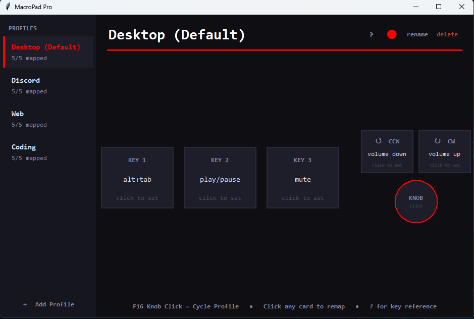

# MacroPad Pro 🎛️

A Windows macro pad controller with persistent layer profiles — built for CH552-based macro pads (and similar devices) that don't have onboard memory.



---

## The Problem This Solves

I bought a cheap CH552 macro pad off AliExpress. The software that came with it assumed the device had onboard memory so it could cycle through profiles by itself — but mine didn't. The pad just sends fixed key codes (F13–F18) every time, with no memory of what "layer" it was supposed to be on.

So I built this: a small Windows app that **lives in your system tray**, intercepts those key codes, and handles all the profile/layer logic in software. Your macros, your profiles, your colors — all saved in a local config file. The pad just sends signals; this app decides what they actually do.

---

## Features

- 🗂️ **Multiple profiles** (Desktop, Media, Gaming, or whatever you want)
- 🎨 **Custom color per profile** — tray icon updates to match
- ⌨️ **Supports hotkeys, media keys, mouse scroll, and typed text**
- 💾 **Persistent config** — survives restarts, saved to `macropad_config.json`
- 🔄 **Knob click (F16) cycles profiles** on the fly
- 🖥️ **Minimizes to system tray** instead of closing
- 📋 **Built-in key reference** (press `?` in the app)

---

## Requirements

- Windows 10 or 11
- Python 3.9+
- **Must be run as Administrator** (required for the `keyboard` library to intercept key presses globally)

---

## Installation

**1. Clone or download this repo**

```
git clone https://github.com/Daniel-Bez/CH552-Macropad-Configurator.git
cd CH552-Macropad-Configurator
```

Or click the green **Code** button → **Download ZIP**, then extract it.

**2. Install dependencies**

```
pip install -r requirements.txt
```

**3. Run as Administrator**

Right-click your terminal (Command Prompt or PowerShell) → **Run as administrator**, then:

```
python macropad.py
```

> ⚠️ If you don't run as admin, the keyboard hooks will silently fail and nothing will work.

---

## Default Key Codes

This app assumes your pad sends these keys by default:

| Physical key | Code sent |
|---|---|
| Key 1 | F13 |
| Key 2 | F14 |
| Key 3 | F15 |
| Knob click | F16 |
| Knob CCW | F17 |
| Knob CW | F18 |

**If your pad sends different codes**, open `macropad.py` and edit these lines near the top:

```python
KEY_CODES  = ["f13", "f14", "f15"]
KNOB_CODES = ["f17", "f18"]
```


---

## Supported Actions

| What you type | What it does |
|---|---|
| `ctrl+c` | Keyboard shortcut (copy) |
| `alt+tab` | Switch window |
| `win+d` | Show desktop |
| `volume up` | Raise system volume |
| `volume down` | Lower system volume |
| `mute` | Toggle mute |
| `play/pause` | Play/pause media |
| `next track` | Skip track |
| `prev track` | Previous track |
| `scroll up` | Mouse wheel up |
| `scroll down` | Mouse wheel down |
| `type: Hello!` | Types literal text |

Press **`?`** inside the app for the full built-in reference with copy-to-clipboard.

---

## Config File

Settings are saved automatically to `macropad_config.json` in the same folder as the script. You can edit it manually if you want, or just delete it to reset to defaults.

---

## License

MIT — do whatever you want with it.
